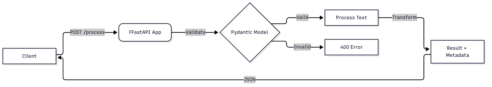
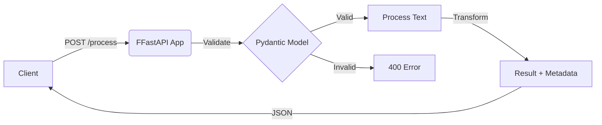

# Veriflow

Verify torrent safety before download

# TextMVP

A minimal text processing service using FastAPI.

## Usage

Run the server:
uvicorn main:app --reload

## API

POST /process
Body: {"text": "string", "operation": "upper|lower|reverse|words"}

## Architecture

Mermaid source

